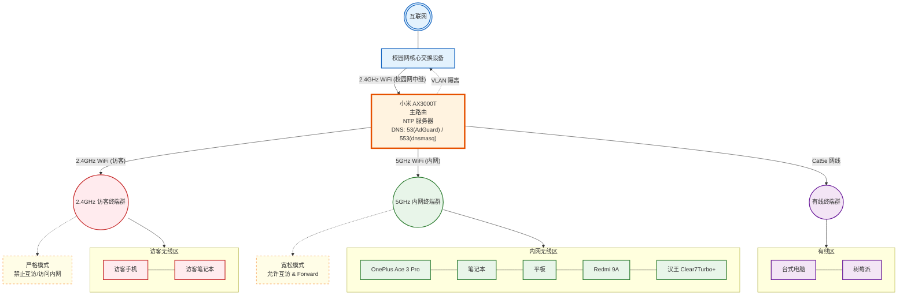
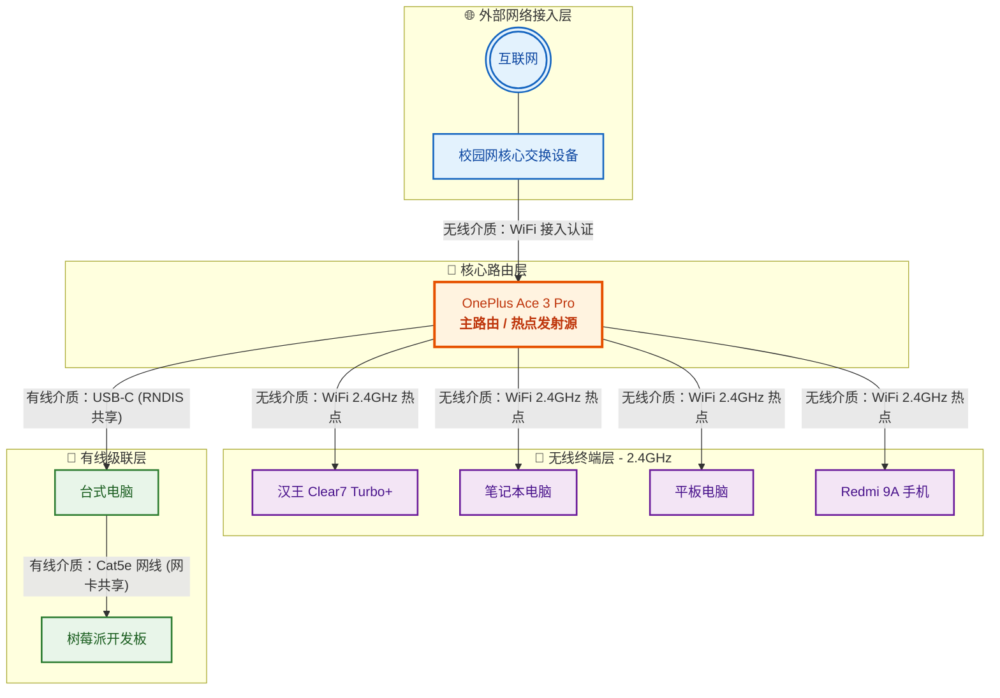

# 【趣闻】从“企业级网络”到“战术级硬核求生”：当我的主路由变砖后……

众所周知，国内高校的校园网普遍都有“最多允许三台设备同时在线”的逆天限制。为了让手底下一堆设备都能安稳上网，我此前精心设计了一套基于小米 AX3000T 的网络拓扑。

原本的架构可以说是“井井有条，固若金汤”：

* 校园网无线中继接入主路由。
* 划分 5GHz 核心内网与 2.4GHz 访客隔离区，调防火墙规则调到吐血。
* 本地搭建 AdGuard Home + dnsmasq 实现 DNS 净化与分流。

### 理想中的标准架构（逝去的辉煌）：

---

## 意外降临：刷机翻车现场

就在前几天，我兴高采烈地准备给路由器升级到最新的 `immortal25` 系统。结果……**啪，变砖了。**

主路由突然暴毙，整个寝室瞬间陷入了断网危机。看着桌上一堆嗷嗷待哺的电子设备，在没有备用路由器的情况下，我不得不开启“战术级硬核求生模式”。

利用手头仅剩的设备和压箱底的网路技术，我花了半小时重新缝合了一套新架构。画完新拓扑图的那一刻，我自己对着屏幕足足笑了一个多小时。

### 现实中的硬核缝合架构（仰卧起坐版）：

---

## 这套架构的“精妙”之处（槽点）

这波操作直接将网络从“企业级规划”降维打击成了“单兵游击队”：

1. **一加手机：从主力机被迫成为“核心网关”**
它不得不一边用 WiFi 连接校园网并进行登录认证，一边疯狂广播 2.4GHz 热点喂饱那一堆无线设备。它的无线双工转发能力和散热在这个夏天迎来了终极考验。
2. **无限 NAT 俄罗斯套娃**
`校园网 NAT` $\to$ `手机热点 NAT` $\to$ `台式机网卡共享 NAT`。只要我套娃叠得够深，校园网的计费检测系统这辈子也别想查出我到底后面挂了几台设备。
3. **树莓派的“赛博孤儿”流浪记**
树莓派作为一个正儿八经的 Linux 节点，它这辈子大概也没想过，自己的数据包要先通过 Cat5e 网线穿过一台大台式机，再通过 USB-C 走 RNDIS 协议穿过一台安卓手机，最后才能摸到互联网的边缘。只要台式机一关机，树莓派当场就地失联。
4. **内网性能的断崖式暴跌**
告别了千兆局域网互访和高速 5GHz，现在所有无线终端在 2.4GHz 的微弱带宽里反复拉扯，局域网传输直接退回十年前，而且一加手机已经隐隐有要鼓包的趋势了……

## 总结

只要思想不滑坡，办法总比困难多！虽然网络延迟感人、内网互访基本瘫痪，但好歹在没花一分钱的情况下，让整个寝室的所有设备都续上了命。

不说了，我要去研究怎么用 U-Boot 给那台变砖的 AX3000T 救砖了。再不把它救回来，我的一加手机就要成为这套硬核架构的第一个“烈士”了！